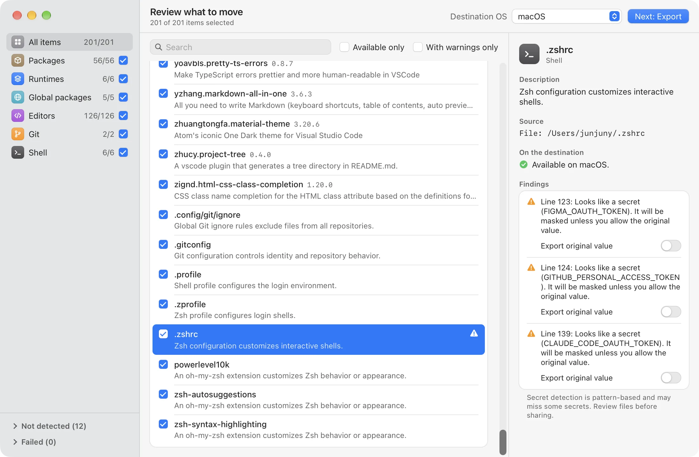
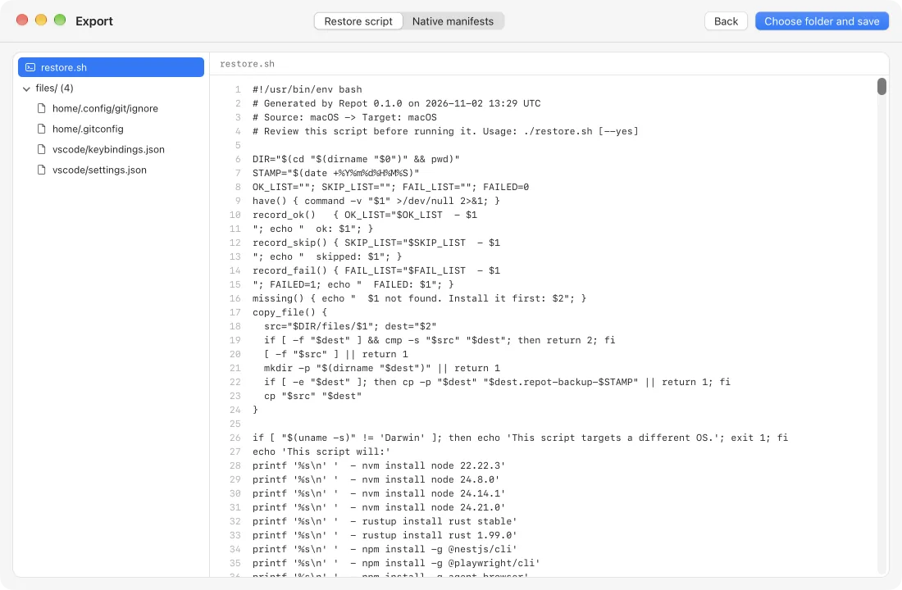

<div align="center">


# Repot

**開発環境をスキャン。新しいコンピュータで復元。**

Repot はコンピュータにインストールされているものを読み取り、各項目を説明し、
実行前に確認できる復元スクリプトを書き出します。コンピュータに変更を加えることはありません。

[](https://github.com/junjuny0227/Repot/releases/latest)
[](https://github.com/junjuny0227/Repot/actions/workflows/ci.yml)
[](LICENSE)

[**ダウンロード**](https://junjuny0227.github.io/Repot/ja/) · [English](README.md) · [한국어](README.ko.md) · [简体中文](README.zh-Hans.md) · [リリース](https://github.com/junjuny0227/Repot/releases/latest) · [設計ドキュメント（韓国語）](docs/specs/2026-11-02-repot-mvp-design.md)

<picture>
  <source media="(prefers-color-scheme: dark)" srcset="apps/site/public/screenshots/review-dark.webp">
  
</picture>

</div>

## できること

- **開発環境を検出します。** macOS、Windows、Linux のパッケージ、ランタイムのバージョン、
  グローバル CLI ツール、エディタの拡張機能と設定、Git 設定、シェルプロファイルを読み取ります。
- **各項目を説明します。** 項目ごとに短い説明を表示し、移行先の OS に移せない場合は警告します。
  説明がない場合は、その旨を表示します。
- **移行するものを選べます。** カテゴリ単位でも項目単位でも選択できます。使用できない項目は
  推測で扱わず、選択できない状態にします。
- **書き出すだけで、インストールはしません。** 読みやすい `restore.sh` / `restore.ps1` または
  ネイティブマニフェスト一式（Brewfile、winget JSON、VS Code 拡張機能リストなど）を作成します。
  新しいコンピュータで実行するかどうかは、自分で決められます。
- **機密情報をマスクします。** 設定ファイル内で見つかったトークンは、別途許可しない限り
  `<REDACTED>` に置き換えます。
- **Repot ファイルを残します。** 書き出すたびに、選んだ項目を記録した `repot.json` も保存します。
  あとで Repot で開けば、元のコンピュータがなくても見直したり、別の移行先に書き出したりできます。
- **アプリ自体を更新できます**（0.2.0 以降）。新しいバージョンをアプリ内からインストールし、
  Repot のアップデート署名鍵で検証します。
- **複数の言語に対応しています。** English、한국어、日本語、简体中文。

## 画面で見る

<table>
  <tr>
    <td width="50%">
      <picture>
        <source media="(prefers-color-scheme: dark)" srcset="apps/site/public/screenshots/review-dark-1100.webp">
        
      </picture>
      <p align="center"><b>確認</b>：各項目の内容と移行できるかどうかを確認</p>
    </td>
    <td width="50%">
      <picture>
        <source media="(prefers-color-scheme: dark)" srcset="apps/site/public/screenshots/export-dark-1100.webp">
        
      </picture>
      <p align="center"><b>書き出し</b>：保存前にスクリプトとファイルをプレビュー</p>
    </td>
  </tr>
</table>

## 移行できるもの

| カテゴリ | ツール |
| --- | --- |
| パッケージ | Homebrew, winget, Scoop, Chocolatey, apt, dnf, pacman |
| ランタイム | nvm, nvm-windows, fnm, Volta, pyenv（pyenv-win を含む）, rustup, SDKMAN! |
| グローバルパッケージ | npm, pnpm, pipx, Cargo |
| エディタ | VS Code と Cursor：拡張機能、設定、キーバインド、スニペット |
| Git | ユーザー設定とグローバル ignore ファイル |
| シェル | zsh、Bash、fish、PowerShell のプロファイル、oh-my-zsh のカスタムプラグインとテーマ、Starship |

同じ OS（Linux では同じディストリビューション系統）に移行する場合、パッケージマネージャーの項目は
元のマネージャーと名前をそのまま使います。別の OS に移行する場合は、アプリに内蔵された
パッケージ対応表（開発ツールとアプリ約 285 個）だけを使います。移行先が macOS なら Homebrew、
Windows なら選択した**パッケージマネージャー**（既定は winget、ほかに Scoop、Chocolatey）、
Linux ならディストリビューション系統に合わせて apt、dnf、pacman を使います。対応表に名前がない
パッケージ、Homebrew の tap、これらの系統以外の Linux ディストリビューションは移行できません。
名前を推測することはありません。ランタイムマネージャーは、OS 間で対応するツールにマッピングします。

## 基本方針

- **スキャンは読み取り専用です。** スキャンはコンピュータを読み取るだけで、書き出し先は選択した
  フォルダに限られます。唯一の例外は、ユーザーが承認したアプリのアップデートです。
- **安全側の動作を既定にしています。** 復元スクリプトは最初に確認を求め、既存の項目をスキップし、
  ファイルを変更する前にバックアップします。パッケージマネージャーを勝手にインストールすることはありません。
- **ネットワーク通信はアプリのアップデートのみです。** Repot は署名済みアップデートの確認と
  ダウンロードのために GitHub に接続します。自動確認は設定で無効にできます。スキャンデータが
  コンピュータの外に送信されることはありません。あとで実行する復元スクリプトは、各ツールを通じて
  パッケージをダウンロードします。

## インストール

[ダウンロードページ](https://junjuny0227.github.io/Repot/ja/)または
[GitHub Releases](https://github.com/junjuny0227/Repot/releases/latest)から最新のベータ版をダウンロードしてください。

| プラットフォーム | パッケージ | 状態 |
| --- | --- | --- |
| macOS（Apple silicon および Intel） | `.dmg` | ベータ |
| Windows 10 / 11（x64） | `.msi`, `-setup.exe` | ベータ |
| Linux（x86_64） | `.AppImage`, `.deb`, `.rpm` | ベータ |

0.x のビルドはまだコード署名・公証を受けていないため、初回起動時に追加の操作が必要です。
アップデートファイルは別のアップデート用署名で検証します。これは Apple/Windows のコード署名とは異なります。

- **macOS：** `.dmg` を開き、Repot をアプリケーションフォルダにドラッグします。Repot を一度開くと、
  macOS が開発元を確認できないと通知します。**システム設定 › プライバシーとセキュリティ**で
  **「このまま開く」**を選択し、確認します。この操作は初回のみ必要です
  （現在の macOS では Control-クリック › 開くでは確認を回避できません）。代わりに、
  `xattr -dr com.apple.quarantine /Applications/Repot.app` を実行することもできます。
- **Windows：** `.msi` またはセットアップ用 `.exe` を開きます。SmartScreen にブロックされた場合は、
  ファイルを信頼できる場合に限り、**詳細情報 › 実行**を選択してください。
- **Linux：** `chmod +x Repot_*.AppImage` を実行してから開くか、ディストリビューションの
  パッケージインストーラーで `.deb` / `.rpm` をインストールします。

### アプリのアップデート

Repot は既定で起動時に一度、GitHub でアップデートを確認します。言語選択の横にある**設定**から、
**アップデートを自動的に確認**を無効にしたり、**今すぐ確認**を実行したりできます。
新しいバージョンの案内は開始画面または完了画面でのみ表示され、スキャンや書き出しの途中には表示されません。
**インストールして再起動**または**あとで**を選択してください。署名済みアップデートはインストール前に検証されます。

- Linux の自動アップデートには **AppImage** が必要です。`.deb` / `.rpm` はパッケージマネージャーで
  更新するか、最新のインストーラーをダウンロードしてください。
- **0.1.0 にはアップデート機能がありません。** 一度だけ、0.2.0 以降を手動でインストールしてください。

## 書き出したファイルの使い方

1. `files/` を含む `repot-export-YYYY-MM-DD/` フォルダ**全体**を移行先のコンピュータにコピーします。
2. スクリプトと同梱ファイルを確認します。機密情報の検出はパターンに基づくもので、完全ではありません。
   見落とされた機密情報がないか確認してください。設定を使う前に、移行先で `<REDACTED>` の
   プレースホルダーを適切な値に置き換えます。
3. 不足しているパッケージマネージャーやランタイムマネージャーは自分でインストールします。
   Repot はインストール用リンクを表示し、マネージャーがない場合は該当箇所をスキップします。
4. 書き出したフォルダで、選択した移行先に対応するスクリプトを実行します。

   **macOS / Linux**

   ```sh
   ./restore.sh
   ```

   **Windows PowerShell 5.1 以降**

   ```powershell
   powershell -ExecutionPolicy Bypass -File restore.ps1
   ```

スクリプトは確認を求め、既存の項目をスキップし、設定ファイルを変更する前にバックアップしたうえで、
成功・スキップ・失敗をまとめて表示します。失敗したステップがある場合、終了コードは 0 以外になります。
出力はすべて確認してください。パッケージのインストールはトランザクションではなく、ロールバックされません。

**ネイティブマニフェスト一式**を使う場合は、書き出された `README.md` に従ってください。
その書き出しに含まれるマニフェスト用のコマンドと、各設定ファイルの配置先が記載されています。
選択した項目に必要なファイルだけが含まれます。

## 既知の制限

- apt と dnf の手動インストール一覧には、基本システムのパッケージが含まれる場合があります。
- winget と Cargo の項目には、ローカルで取得できる説明がありません。
- マネージャー間の重複は、名前が同じ場合のみ検出します（大文字・小文字は区別しません）。
  自動では削除しません。
- OS 間のパッケージ対応表は約 285 個のパッケージを扱い、各名前は移行先マネージャーの既定の
  リポジトリ（Scoop は公式 bucket を含む）で確認済みです。それ以外のパッケージは別の OS に
  移行できません。復元を実行する前に、対応付けられた名前を確認してください。
- パターンに基づく検出では、すべての機密情報を見つけることはできません。特に、検出された機密情報を
  元の値で書き出す場合は、書き出したファイルを必ず確認してください。
- WSL と Git Bash の環境には対応していません。
- winget は `winget` ソースのみを扱い、Microsoft Store（`msstore`）のパッケージは扱いません。
- Volta はランタイムのみをスキャンし、Volta でインストールしたグローバルパッケージはスキャンしません。
- rustup はツールチェーンのみをスキャンし、コンポーネントやターゲットはスキャンしません。
- Scoop は既定の bucket 以外のカスタム bucket URL を保持しません。
- `repot.json` には、その書き出しに含まれた項目だけが入ります。移行先で使えずに除外された項目は、
  あとでファイルから書き出せません。伏せた機密情報も伏せたままです。

## ソースからビルド

必要なもの：**Rust stable**（rustfmt と Clippy を含む）、**Node.js 22**、`package.json` で固定された
バージョンの pnpm。デスクトップ版のビルドには、Tauri 2 のネイティブビルド用の前提ツールも必要です
（macOS では Xcode Command Line Tools、Windows では Microsoft C++ Build Tools と WebView2）。

Debian/Ubuntu では、次のネイティブビルド用パッケージをインストールします。
`libwebkit2gtk-4.1-dev build-essential curl wget file libxdo-dev libssl-dev libayatana-appindicator3-dev librsvg2-dev`。
ほかの Linux ディストリビューションでは、対応する Tauri 2 の依存パッケージを使用してください。

リポジトリのルートで実行します。

```sh
pnpm install
pnpm --filter @repot/desktop tauri dev
```

Tauri はコンパイル時に `apps/desktop/dist` を組み込むため、テストでは Rust ワークスペースを
コンパイルする**前に**フロントエンドをビルドしてください。

```sh
pnpm --filter @repot/desktop build
cargo test --workspace
cargo run -p repot-core --example scan
```

scan サンプルはローカル環境を読み取って JSON を出力するだけで、復元やインストールは行いません。
CI は macOS、Windows、Ubuntu で Rust のチェック、実環境のスキャン、復元のスモークテストを実行し、
フロントエンドの型チェック、テスト、ビルドも行います。リリースワークフローでのビルドには対応する
バージョンタグが必要で、"Repot <version> (beta)" という名前のドラフトリリースを作成します。
公開するかどうかは、人が別途判断します。

## ドキュメント

- [MVP 設計](docs/specs/2026-11-02-repot-mvp-design.md)（韓国語）
- [実装計画](docs/plans/)（韓国語）
- [製品サイトのソース](apps/site/)

## ライセンス

[Apache-2.0](LICENSE)。
