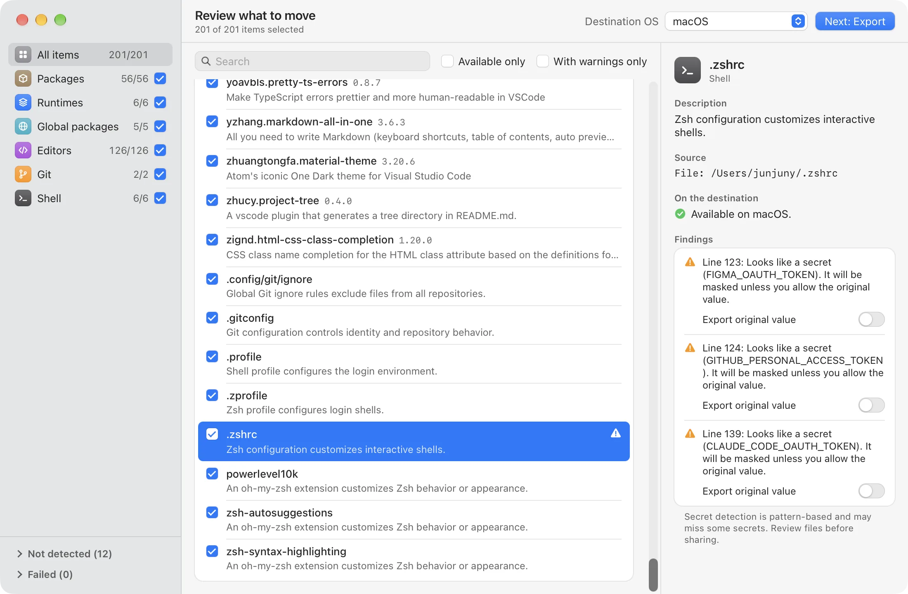
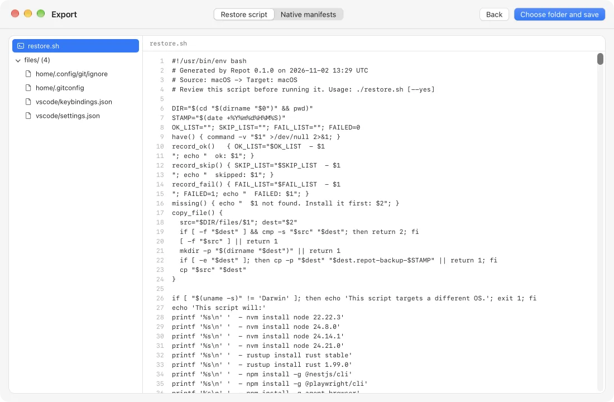

<div align="center">


# Repot

**개발 환경을 스캔하고, 새 기기에서 복원하세요.**

Repot은 기기에 설치된 것을 읽어 항목마다 설명하고, 실행 전에 직접 검토할 수 있는
복원 스크립트로 내보냅니다. 기기는 절대 바꾸지 않습니다.

[](https://github.com/junjuny0227/Repot/releases/latest)
[](https://github.com/junjuny0227/Repot/actions/workflows/ci.yml)
[](LICENSE)

[**다운로드**](https://junjuny0227.github.io/Repot/ko/) · [English](README.md) · [릴리스](https://github.com/junjuny0227/Repot/releases/latest) · [설계 문서](docs/specs/2026-11-02-repot-mvp-design.md)

<picture>
  <source media="(prefers-color-scheme: dark)" srcset="apps/site/public/screenshots/review-dark.webp">
  
</picture>

</div>

## 하는 일

- **개발 환경을 찾습니다.** 패키지, 런타임 버전, 전역 CLI 도구, 에디터 확장과 설정,
  Git 설정, 셸 프로필을 macOS, Windows, Linux에서 읽습니다.
- **모든 항목을 설명합니다.** 항목마다 짧은 설명이 붙고, 대상 OS로 옮길 수 없으면
  경고를 보여 줍니다. 설명이 없으면 없다고 말합니다.
- **고를 수 있습니다.** 카테고리나 항목 단위로 옮길 것을 고릅니다. 옮길 수 없는 항목은
  추측하지 않고 비활성화합니다.
- **내보내기만 하고 설치하지 않습니다.** 읽기 쉬운 `restore.sh` / `restore.ps1`이나
  네이티브 매니페스트 묶음(Brewfile, winget JSON, VS Code 확장 목록 등)을 만듭니다.
  새 기기에서 실행할지는 직접 정합니다.
- **시크릿을 가립니다.** 설정 파일에서 찾은 토큰은 따로 선택하지 않는 한 `<REDACTED>`로
  바꿉니다.
- **스스로 업데이트합니다**(0.2.0부터). 새 버전을 앱 안에서 설치하고, Repot의 업데이트
  서명 키로 검증합니다.
- **여러 언어를 지원합니다.** English, 한국어, 日本語, 简体中文.

## 자세히 보기

<table>
  <tr>
    <td width="50%">
      <picture>
        <source media="(prefers-color-scheme: dark)" srcset="apps/site/public/screenshots/review-dark-1100.webp">
        
      </picture>
      <p align="center"><b>검토</b>: 항목이 무엇인지, 옮길 수 있는지</p>
    </td>
    <td width="50%">
      <picture>
        <source media="(prefers-color-scheme: dark)" srcset="apps/site/public/screenshots/export-dark-1100.webp">
        
      </picture>
      <p align="center"><b>내보내기</b>: 저장하기 전에 스크립트와 파일 미리 보기</p>
    </td>
  </tr>
</table>

## 옮길 수 있는 것

| 카테고리 | 도구 |
| --- | --- |
| 패키지 | Homebrew, winget, Scoop, Chocolatey, apt, dnf, pacman |
| 런타임 | nvm, nvm-windows, fnm, Volta, pyenv(pyenv-win 포함), rustup, SDKMAN! |
| 전역 패키지 | npm, pnpm, pipx, Cargo |
| 에디터 | VS Code와 Cursor의 확장, 설정, 단축키, 스니펫 |
| Git | 사용자 설정과 전역 ignore 파일 |
| 셸 | zsh, Bash, fish, PowerShell 프로필, oh-my-zsh 사용자 플러그인과 테마, Starship |

패키지 매니저 항목은 같은 OS(Linux는 같은 배포판 계열)로만 옮길 수 있습니다.
런타임 매니저는 OS 사이에서 대응되는 도구로 바꿔 줍니다.

## 원칙

- **스캔은 읽기만 합니다.** 스캔은 기기를 읽기만 하고, 내보내기는 고른 폴더에만 씁니다.
  유일한 예외는 사용자가 승인한 앱 업데이트입니다.
- **기본값은 보수적입니다.** 복원 스크립트는 먼저 확인을 받고, 이미 있는 것은 건너뛰고,
  파일을 바꾸기 전에 백업하며, 패키지 매니저를 대신 설치하지 않습니다.
- **네트워크는 앱 업데이트에만 씁니다.** Repot은 서명된 업데이트를 확인하고 내려받을
  때만 GitHub에 연결하며, 자동 확인은 설정에서 끌 수 있습니다. 스캔 데이터는 기기 밖으로
  나가지 않습니다. 나중에 직접 실행하는 복원 스크립트는 각 도구를 통해 패키지를
  내려받습니다.

## 설치

[다운로드 페이지](https://junjuny0227.github.io/Repot/ko/)나
[GitHub Releases](https://github.com/junjuny0227/Repot/releases/latest)에서 최신 베타를
받으세요.

| 플랫폼 | 패키지 | 상태 |
| --- | --- | --- |
| macOS (Apple silicon, Intel) | `.dmg` | 베타 |
| Windows 10 / 11 (x64) | `.msi`, `-setup.exe` | 베타 |
| Linux (x86_64) | `.AppImage`, `.deb`, `.rpm` | 베타 |

0.x 빌드는 아직 코드 서명과 공증을 받지 않아서 처음 실행할 때 한 단계가 더 필요합니다.
업데이트 파일은 별도의 업데이트 서명으로 검증하며, 이것은 Apple/Windows 코드 서명이
아닙니다.

- **macOS:** `.dmg`를 열고 Repot을 응용 프로그램 폴더로 끌어다 놓습니다. Repot을 한 번
  열면 macOS가 개발자를 확인할 수 없다고 알립니다. **시스템 설정 › 개인정보 보호 및 보안**에서
  **그래도 열기**를 누르고 확인합니다. 처음 한 번만 하면 됩니다(최신 macOS에서는
  Control-클릭 › 열기로 넘어갈 수 없습니다). 터미널에서
  `xattr -dr com.apple.quarantine /Applications/Repot.app`을 실행해도 됩니다.
- **Windows:** `.msi`나 설치용 `.exe`를 엽니다. SmartScreen이 막으면 파일을 믿을 수 있을
  때만 **추가 정보 › 실행**을 누릅니다.
- **Linux:** `chmod +x Repot_*.AppImage`로 실행 권한을 주고 열거나, `.deb` / `.rpm`을
  배포판의 패키지 설치 도구로 설치합니다.

### 앱 업데이트

Repot은 기본으로 실행할 때 한 번 GitHub에서 업데이트를 확인합니다. 언어 선택 옆의
**설정**에서 **업데이트 자동 확인**을 끄거나 **지금 확인**을 누를 수 있습니다. 새 버전
안내는 시작 화면이나 완료 화면에서만 뜨고, 스캔이나 내보내기 도중에는 뜨지 않습니다.
**설치 및 재시작**이나 **나중에**를 고르면 되고, 서명된 업데이트는 설치 전에 검증합니다.

- Linux 자동 업데이트는 **AppImage**에서만 됩니다. `.deb` / `.rpm`은 패키지 매니저로
  업데이트하거나 최신 설치 파일을 다시 받으세요.
- **0.1.0에는 업데이트 기능이 없습니다.** 0.2.0 이상을 한 번 직접 설치해 주세요.

## 내보낸 파일 사용하기

1. `repot-export-YYYY-MM-DD/` 폴더를 `files/`까지 **통째로** 대상 기기에 복사합니다.
2. 스크립트와 복사할 파일을 읽어 봅니다. 시크릿 탐지는 패턴 기반이라 완벽하지 않으니,
   놓친 시크릿이 없는지 확인하세요. 설정을 쓰기 전에 대상 기기에서 `<REDACTED>` 자리를
   알맞은 값으로 바꿉니다.
3. 없는 패키지 매니저나 런타임 매니저는 직접 설치합니다. Repot은 설치 링크를 보여 주고,
   매니저가 없으면 그 부분을 건너뜁니다.
4. 내보낸 폴더에서 대상 OS에 맞는 스크립트를 실행합니다.

   **macOS / Linux**

   ```sh
   ./restore.sh
   ```

   **Windows PowerShell 5.1 이상**

   ```powershell
   powershell -ExecutionPolicy Bypass -File restore.ps1
   ```

스크립트는 확인을 받은 뒤, 이미 있는 항목은 건너뛰고, 설정 파일을 바꾸기 전에 백업하며,
성공·건너뜀·실패를 요약합니다. 실패한 단계가 있으면 종료 코드가 0이 아닙니다. 출력을 모두
확인하세요. 패키지 설치는 트랜잭션이 아니어서 되돌려지지 않습니다.

**네이티브 매니페스트 묶음**은 내보낸 `README.md`를 따르세요. 그 내보내기에 들어 있는
매니페스트별 명령과 설정 파일을 둘 위치가 적혀 있습니다. 묶음에는 고른 항목에 필요한
파일만 들어갑니다.

## 알려진 제한

- apt와 dnf의 수동 설치 목록에 기본 시스템 패키지가 섞일 수 있습니다.
- winget과 Cargo 항목에는 로컬 설명이 없습니다.
- 매니저 사이의 중복은 이름이 같을 때만(대소문자 무시) 감지하고 자동으로 지우지 않습니다.
  패키지 이름은 OS 사이에서 대응시키지 않습니다.
- 패턴 기반 시크릿 탐지로 모든 시크릿을 찾을 수는 없습니다. 특히 탐지된 시크릿을 드러내기로
  했다면 내보낸 파일을 꼭 검토하세요.
- WSL과 Git Bash 환경은 지원하지 않습니다.
- winget은 `winget` 소스만 다루고, Microsoft Store(`msstore`) 패키지는 다루지 않습니다.
- Volta는 런타임만 스캔하고, Volta로 설치한 전역 패키지는 스캔하지 않습니다.
- rustup은 툴체인만 스캔하고, 컴포넌트와 타깃은 스캔하지 않습니다.
- Scoop은 기본 bucket 외의 사용자 bucket URL을 보존하지 않습니다.

## 소스에서 빌드하기

준비물: **Rust stable**(rustfmt, Clippy 포함), **Node.js 22**, `package.json`에 고정된
pnpm 버전. 데스크톱 빌드에는 Tauri 2의 네이티브 빌드 준비물도 필요합니다(macOS는 Xcode
Command Line Tools, Windows는 Microsoft C++ Build Tools와 WebView2).

Debian/Ubuntu에서는 다음 패키지를 설치합니다.
`libwebkit2gtk-4.1-dev build-essential curl wget file libxdo-dev libssl-dev libayatana-appindicator3-dev librsvg2-dev`.
다른 Linux 배포판은 그에 맞는 Tauri 2 의존성을 설치하세요.

저장소 루트에서:

```sh
pnpm install
pnpm --filter @repot/desktop tauri dev
```

Tauri가 컴파일할 때 `apps/desktop/dist`를 포함하므로, 테스트할 때는 Rust 워크스페이스를
컴파일하기 **전에** 프론트엔드를 먼저 빌드합니다.

```sh
pnpm --filter @repot/desktop build
cargo test --workspace
cargo run -p repot-core --example scan
```

scan 예제는 로컬 환경을 읽어 JSON으로 출력할 뿐, 복원하거나 설치하지 않습니다. CI는
macOS, Windows, Ubuntu에서 Rust 검사, 실제 스캔, 복원 스모크 테스트를 돌리고, 프론트엔드
타입 검사, 테스트, 빌드도 돌립니다. 릴리스 워크플로는 버전과 맞는 태그가 있어야 빌드하고
"Repot <version> (beta)"라는 초안 릴리스를 만듭니다. 공개는 사람이 따로 결정합니다.

## 문서

- [MVP 설계](docs/specs/2026-11-02-repot-mvp-design.md)
- [구현 계획](docs/plans/)
- [제품 사이트 소스](apps/site/)

## 라이선스

[Apache-2.0](LICENSE).
