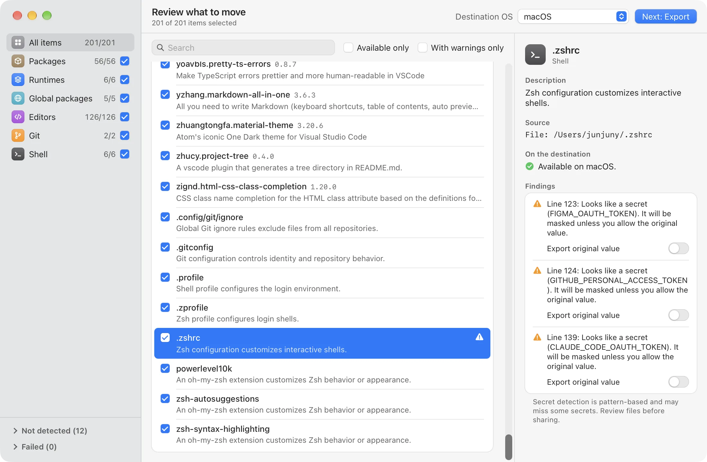
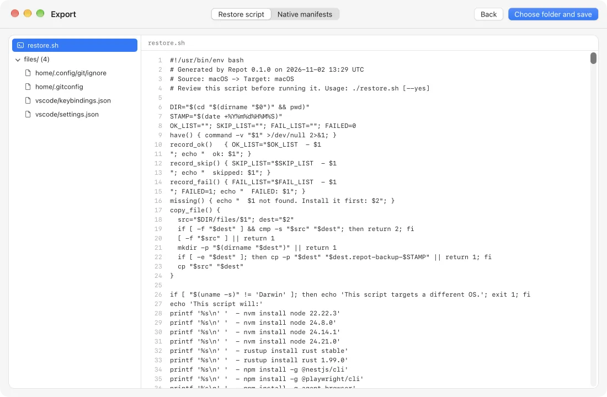

<div align="center">


# Repot

**Scan your dev setup. Restore it on a new machine.**

Repot reads what your machine has installed, explains each item, and exports a
restore script you review before running. It never changes your device.

[](https://github.com/junjuny0227/Repot/releases/latest)
[](https://github.com/junjuny0227/Repot/actions/workflows/ci.yml)
[](LICENSE)

[**Download**](https://junjuny0227.github.io/Repot/) · [한국어](README.ko.md) · [日本語](README.ja.md) · [简体中文](README.zh-Hans.md) · [Releases](https://github.com/junjuny0227/Repot/releases/latest) · [Design (Korean)](docs/specs/2026-11-02-repot-mvp-design.md)

<picture>
  <source media="(prefers-color-scheme: dark)" srcset="apps/site/public/screenshots/review-dark.webp">
  
</picture>

</div>

## What it does

- **Finds your dev environment**: packages, runtime versions, global CLI tools,
  editor extensions and settings, Git config and shell profiles, on macOS, Windows
  and Linux.
- **Explains every item.** Each one comes with a short description and a warning when
  it cannot move to the destination OS. When Repot has no description, it says so.
- **Lets you pick.** Select what to move by category or item; unavailable items are
  disabled rather than guessed.
- **Exports, never installs.** You get a readable `restore.sh` / `restore.ps1` or a
  bundle of native manifests (Brewfile, winget JSON, VS Code extension list and so on).
  You decide whether to run it on the new machine.
- **Masks secrets.** Tokens found in config files are replaced with `<REDACTED>` unless
  you choose otherwise.
- **Keeps a Repot file.** Every export also writes `repot.json` with the items you
  chose. Open it in Repot later to review again or export for another destination,
  without the old machine.
- **Updates itself** (from 0.2.0). New versions install from inside the app, verified
  against Repot's update signing key.
- **Speaks your language**: English, 한국어, 日本語 and 简体中文.

## A closer look

<table>
  <tr>
    <td width="50%">
      <picture>
        <source media="(prefers-color-scheme: dark)" srcset="apps/site/public/screenshots/review-dark-1100.webp">
        
      </picture>
      <p align="center"><b>Review</b>: what each item is and whether it can move</p>
    </td>
    <td width="50%">
      <picture>
        <source media="(prefers-color-scheme: dark)" srcset="apps/site/public/screenshots/export-dark-1100.webp">
        
      </picture>
      <p align="center"><b>Export</b>: preview the script and files before saving</p>
    </td>
  </tr>
</table>

## What it moves

| Category | Tools |
| --- | --- |
| Packages | Homebrew, winget, Scoop, Chocolatey, apt, dnf, pacman |
| Runtimes | nvm, nvm-windows, fnm, Volta, pyenv (including pyenv-win), rustup, SDKMAN! |
| Global packages | npm, pnpm, pipx, Cargo |
| Editors | VS Code and Cursor: extensions, settings, keybindings, snippets |
| Git | User configuration and the global ignore file |
| Shell | zsh, Bash, fish and PowerShell profiles, oh-my-zsh custom plugins and themes, Starship |

Within the same OS (and Linux distribution family), package-manager entries keep
their original manager and name. For a different OS, Repot uses only the package map
built into the app (about 285 developer tools and apps): macOS destinations use
Homebrew, Windows destinations use the **Package manager** you pick (winget by
default, Scoop or Chocolatey), and Linux destinations use apt, dnf or pacman for the
distribution family. Packages without a name in the map, Homebrew taps, and Linux
distributions outside these families stay unavailable; names are never guessed.
Runtime managers are mapped between operating systems.

## Principles

- **Read-only scans.** Scans only read your device; exports write only to the folder
  you choose. The one exception is an app update you approve.
- **Conservative by default.** The restore script asks first, skips what is already
  there, backs up files before changing them, and never installs package managers for
  you.
- **Network only for app updates.** Repot talks to GitHub to check for and download
  signed updates; automatic checks can be turned off in Settings. Scan data never
  leaves your machine. The restore script you run later downloads packages through
  their own tools.

## Install

Download the latest beta from the [download page](https://junjuny0227.github.io/Repot/)
or [GitHub Releases](https://github.com/junjuny0227/Repot/releases/latest).

| Platform | Package | Status |
| --- | --- | --- |
| macOS (Apple silicon and Intel) | `.dmg` | Beta |
| Windows 10 / 11 (x64) | `.msi`, `-setup.exe` | Beta |
| Linux (x86_64) | `.AppImage`, `.deb`, `.rpm` | Beta |

0.x builds are not code-signed or notarized yet, so the first launch needs one extra
step. Update bundles are verified with a separate updater signature; this is not
Apple/Windows code signing.

- **macOS:** open the `.dmg` and drag Repot to Applications. Open Repot once; macOS
  says it cannot verify the developer. Then open **System Settings › Privacy &
  Security**, choose **Open Anyway**, and confirm. This is needed only the first time
  (Control-click › Open no longer bypasses the check on current macOS). Alternatively:
  `xattr -dr com.apple.quarantine /Applications/Repot.app`.
- **Windows:** open the `.msi` or setup `.exe`. If SmartScreen blocks it, choose
  **More info › Run anyway** only if you trust the file.
- **Linux:** `chmod +x Repot_*.AppImage` and open it, or install the `.deb` / `.rpm`
  with your distribution's package installer.

### App updates

Repot checks GitHub once on launch by default. Open **Settings** next to the language
picker to turn off **Check for updates automatically** or use **Check now**. A new
version is offered only on the start or done screen, never during a scan or export.
Choose **Install and Restart** or **Later**; the signed update is verified before it
is installed.

- Linux automatic updates need the **AppImage**. For `.deb` / `.rpm`, update through
  your package manager or download the latest installer.
- **0.1.0 has no updater**: install 0.2.0 or later manually once.

## Using an export

1. Copy the **whole** `repot-export-YYYY-MM-DD/` folder to the destination machine,
   including `files/`.
2. Read the script and payloads. Secret detection is pattern-based, not a guarantee:
   check for secrets the detector may have missed. Replace `<REDACTED>` placeholders
   with the appropriate values on the destination before using the configuration.
3. Install any missing package or runtime managers yourself; Repot prints their
   installation links and skips those sections if they are absent.
4. From the export folder, run the script for the selected destination:

   **macOS / Linux**

   ```sh
   ./restore.sh
   ```

   **Windows PowerShell 5.1 or later**

   ```powershell
   powershell -ExecutionPolicy Bypass -File restore.ps1
   ```

The script asks for confirmation, skips existing items, backs up configuration
files before changing them, and summarizes successes, skips and failures. A failed
step makes its exit code nonzero. Review all output; package installation is not
transactional and is not rolled back.

For a **native manifest bundle**, follow the exported `README.md` instead. It lists
commands for the manifests present in that export and the destinations for each
configuration payload. These bundles contain only the files needed for your
selection.

## Known limitations

- apt and dnf's manually installed lists may include base-system packages.
- winget and Cargo entries have no local descriptions.
- Cross-manager duplicates are detected only by identical names (case-insensitive),
  not automatically removed.
- The cross-OS package map covers about 285 packages, each checked against the
  destination manager's default repositories (official Scoop buckets included).
  Other packages cannot move to a different OS. Check mapped names before you run
  the restore.
- Pattern-based secret detection cannot find every secret. Always review exports,
  especially if you choose to reveal a detected secret.
- WSL and Git Bash environments are not supported.
- winget handles only the `winget` source, not Microsoft Store (`msstore`) packages.
- Volta scans runtimes only, not global packages installed through Volta.
- rustup scans toolchains only, not components or targets.
- Scoop does not preserve custom bucket URLs other than its default bucket.
- `repot.json` holds only the items its export contained. Items left out because they
  could not move to that destination cannot be exported from the file later, and
  masked secrets stay masked.

## Build from source

Prerequisites: **Rust stable** (with rustfmt and Clippy), **Node.js 22**, and the
pnpm version pinned in `package.json`. Desktop builds also need the native Tauri 2
build prerequisites (Xcode Command Line Tools on macOS, Microsoft C++ Build Tools
and WebView2 on Windows).

On Debian/Ubuntu, install these native build packages:
`libwebkit2gtk-4.1-dev build-essential curl wget file libxdo-dev libssl-dev libayatana-appindicator3-dev librsvg2-dev`.
Use equivalent Tauri 2 dependencies for other Linux distributions.

From the repository root:

```sh
pnpm install
pnpm --filter @repot/desktop tauri dev
```

For tests, build the frontend **before** compiling the Rust workspace because
Tauri embeds `apps/desktop/dist` at compile time:

```sh
pnpm --filter @repot/desktop build
cargo test --workspace
cargo run -p repot-core --example scan
```

The scan example reads your local environment and prints JSON; it does not restore
or install anything. CI runs Rust checks, real scans and restore smoke tests on
macOS, Windows and Ubuntu, plus frontend type checks, tests and build. Release
workflow builds require a matching version tag and create a draft release named
"Repot <version> (beta)"; publishing is a separate human decision.

## Docs

- [MVP design](docs/specs/2026-11-02-repot-mvp-design.md) (Korean)
- [Implementation plans](docs/plans/) (Korean)
- [Product site source](apps/site/)

## License

[Apache-2.0](LICENSE).
