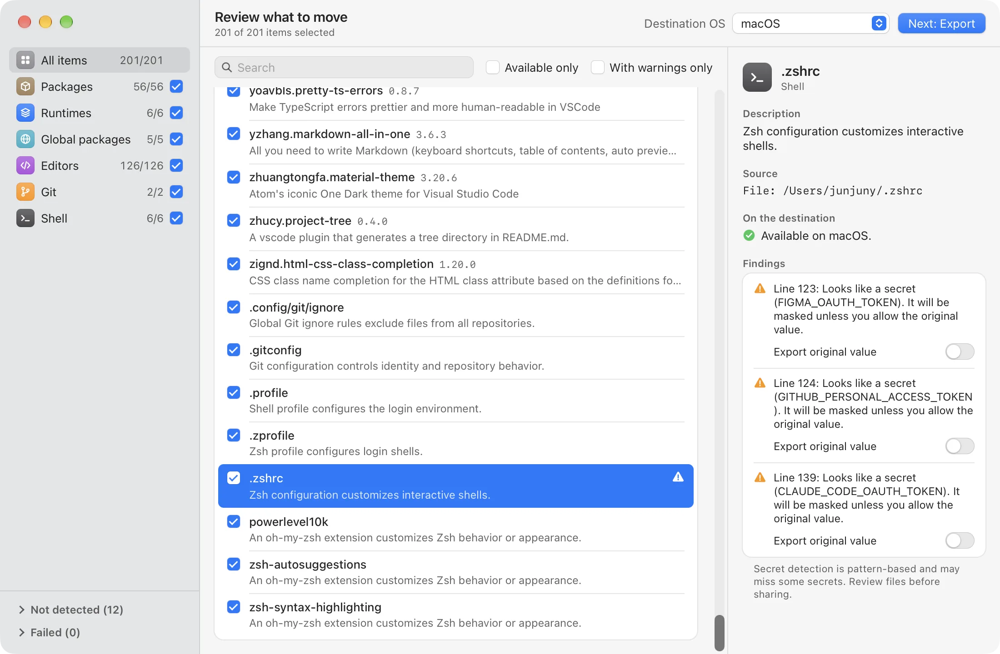
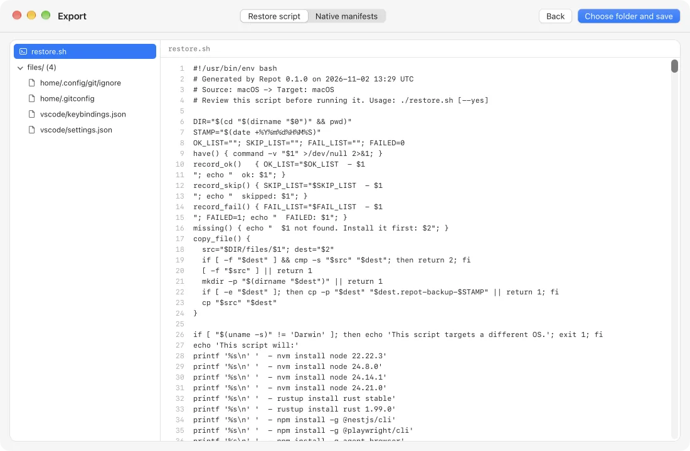

<div align="center">


# Repot

**扫描开发环境，在新电脑上恢复。**

Repot 读取电脑上已安装的内容，逐项提供说明，并导出恢复脚本，供你检查后再运行。
它不会更改你的设备。

[](https://github.com/junjuny0227/Repot/releases/latest)
[](https://github.com/junjuny0227/Repot/actions/workflows/ci.yml)
[](LICENSE)

[**下载**](https://junjuny0227.github.io/Repot/zh-Hans/) · [English](README.md) · [한국어](README.ko.md) · [日本語](README.ja.md) · [发布](https://github.com/junjuny0227/Repot/releases/latest) · [设计文档（韩语）](docs/specs/2026-11-02-repot-mvp-design.md)

<picture>
  <source media="(prefers-color-scheme: dark)" srcset="apps/site/public/screenshots/review-dark.webp">
  
</picture>

</div>

## 功能

- **发现开发环境**：在 macOS、Windows 和 Linux 上读取软件包、运行时版本、全局 CLI 工具、
  编辑器扩展与设置、Git 配置和 Shell 配置文件。
- **逐项说明。** 每个项目都有简短描述，无法迁移到目标系统时会显示警告。
  没有描述时，Repot 也会如实说明。
- **由你选择。** 按类别或项目选择要迁移的内容；不可用的项目会被禁用，而不是靠猜测处理。
- **只导出，不安装。** 生成可读的 `restore.sh` / `restore.ps1`，或原生清单包
  （Brewfile、winget JSON、VS Code 扩展列表等）。是否在新电脑上运行，由你决定。
- **遮盖敏感信息。** 除非你另行选择，否则配置文件中检测到的令牌会被替换为 `<REDACTED>`。
- **保留 Repot 文件。** 每次导出都会同时写入记录所选项目的 `repot.json`。之后在 Repot 中打开它，
  无需旧电脑即可重新查看或导出到其他目标。
- **应用内更新**（从 0.2.0 起）。在应用内安装新版本，并通过 Repot 的更新签名密钥验证。
- **支持多种语言**：English、한국어、日本語 和 简体中文。

## 界面一览

<table>
  <tr>
    <td width="50%">
      <picture>
        <source media="(prefers-color-scheme: dark)" srcset="apps/site/public/screenshots/review-dark-1100.webp">
        
      </picture>
      <p align="center"><b>检查</b>：了解每个项目是什么，以及能否迁移</p>
    </td>
    <td width="50%">
      <picture>
        <source media="(prefers-color-scheme: dark)" srcset="apps/site/public/screenshots/export-dark-1100.webp">
        
      </picture>
      <p align="center"><b>导出</b>：保存前预览脚本和文件</p>
    </td>
  </tr>
</table>

## 可迁移的内容

| 类别 | 工具 |
| --- | --- |
| 软件包 | Homebrew、winget、Scoop、Chocolatey、apt、dnf、pacman |
| 运行时 | nvm、nvm-windows、fnm、Volta、pyenv（包括 pyenv-win）、rustup、SDKMAN! |
| 全局软件包 | npm、pnpm、pipx、Cargo |
| 编辑器 | VS Code 和 Cursor：扩展、设置、键盘快捷键、代码片段 |
| Git | 用户配置和全局忽略文件 |
| Shell | zsh、Bash、fish 和 PowerShell 配置文件、oh-my-zsh 自定义插件与主题、Starship |

迁移到相同的操作系统（Linux 还需属于同一发行版系列）时，软件包管理器的项目沿用原来的管理器和名称。
迁移到其他操作系统时，Repot 只使用应用内置的软件包对照表（约 285 个开发工具和应用）：
目标为 macOS 时使用 Homebrew，目标为 Windows 时使用你选择的**软件包管理器**（默认 winget，
也可选 Scoop 或 Chocolatey），目标为 Linux 时按发行版系列使用 apt、dnf 或 pacman。
对照表中没有名称的软件包、Homebrew tap 以及这些系列之外的 Linux 发行版无法迁移；Repot 不会猜测名称。
运行时管理器会在不同操作系统之间映射到对应工具。

## 原则

- **只读扫描。** 扫描只读取设备；导出只写入你选择的文件夹。
  唯一的例外是经你批准的应用更新。
- **默认采取保守做法。** 恢复脚本会先征求确认，跳过已有内容，在修改文件前备份，
  且不会替你安装软件包管理器。
- **仅应用更新需要联网。** Repot 连接 GitHub 检查并下载已签名的更新；可在设置中关闭自动检查。
  扫描数据不会离开你的电脑。之后由你运行的恢复脚本会通过各工具自行下载软件包。

## 安装

从[下载页面](https://junjuny0227.github.io/Repot/zh-Hans/)
或 [GitHub Releases](https://github.com/junjuny0227/Repot/releases/latest) 下载最新测试版。

| 平台 | 安装包 | 状态 |
| --- | --- | --- |
| macOS（Apple silicon 和 Intel） | `.dmg` | 测试版 |
| Windows 10 / 11（x64） | `.msi`、`-setup.exe` | 测试版 |
| Linux（x86_64） | `.AppImage`、`.deb`、`.rpm` | 测试版 |

0.x 版本尚未进行代码签名或公证，因此首次启动需要额外操作。
更新包通过独立的更新签名进行验证；这不等同于 Apple/Windows 代码签名。

- **macOS：** 打开 `.dmg`，将 Repot 拖入“应用程序”。首次打开 Repot 时，macOS 会提示无法验证开发者。
  随后打开**系统设置 › 隐私与安全性**，选择**仍要打开**并确认。此操作只需进行一次
  （在当前 macOS 中，按住 Control 键点按 › 打开已无法绕过检查）。也可以运行：
  `xattr -dr com.apple.quarantine /Applications/Repot.app`。
- **Windows：** 打开 `.msi` 或安装用的 `.exe`。如果被 SmartScreen 阻止，
  请仅在信任该文件时选择**更多信息 › 仍要运行**。
- **Linux：** 运行 `chmod +x Repot_*.AppImage` 后打开文件，或使用发行版的软件包安装工具
  安装 `.deb` / `.rpm`。

### 应用更新

Repot 默认在启动时向 GitHub 检查一次更新。打开语言选择器旁的**设置**，
可关闭**自动检查更新**，也可使用**立即检查**。新版本提示只会出现在开始或完成界面，
不会在扫描或导出过程中出现。选择**安装并重启**或**稍后**；已签名的更新会在安装前验证。

- Linux 自动更新需要使用 **AppImage**。对于 `.deb` / `.rpm`，请通过软件包管理器更新，
  或下载最新安装包。
- **0.1.0 没有更新功能**：请先手动安装一次 0.2.0 或更高版本。

## 使用导出内容

1. 将**整个** `repot-export-YYYY-MM-DD/` 文件夹复制到目标电脑，包括 `files/`。
2. 检查脚本及随附文件。敏感信息检测基于模式匹配，无法保证全部检出：
   请检查是否有遗漏。在使用配置前，请在目标电脑上将 `<REDACTED>` 占位符替换为适当的值。
3. 自行安装缺少的软件包管理器或运行时管理器；Repot 会输出安装链接，
   并在管理器缺失时跳过相应部分。
4. 在导出文件夹中，运行适用于所选目标系统的脚本：

   **macOS / Linux**

   ```sh
   ./restore.sh
   ```

   **Windows PowerShell 5.1 或更高版本**

   ```powershell
   powershell -ExecutionPolicy Bypass -File restore.ps1
   ```

脚本会征求确认，跳过已有项目，在修改配置文件前备份，并汇总成功、跳过和失败的结果。
任何步骤失败都会使退出码非零。请检查所有输出；软件包安装不具有事务性，也不会回滚。

对于**原生清单包**，请改为遵循导出的 `README.md`。其中列出了该次导出所含清单的使用命令，
以及各配置文件应放置的位置。清单包只包含所选项目需要的文件。

## 已知限制

- apt 和 dnf 的手动安装列表可能包含系统基础软件包。
- winget 和 Cargo 项目没有本地描述。
- 不同管理器之间的重复项目仅按相同名称检测（不区分大小写），不会自动去重。
- 跨操作系统的软件包对照表涵盖约 285 个软件包，每个名称都已在目标管理器的默认仓库
  （Scoop 包括官方 bucket）中确认。其他软件包无法迁移到不同的操作系统。运行恢复前请检查对应的名称。
- 基于模式匹配的敏感信息检测无法找出所有敏感信息。请始终检查导出内容，
  尤其是在选择保留检测到的敏感信息原始值时。
- 不支持 WSL 和 Git Bash 环境。
- winget 仅处理 `winget` 源，不处理 Microsoft Store（`msstore`）软件包。
- Volta 仅扫描运行时，不扫描通过 Volta 安装的全局软件包。
- rustup 仅扫描工具链，不扫描组件或目标平台。
- Scoop 不保留默认 bucket 之外的自定义 bucket URL。
- `repot.json` 只包含该次导出中的项目。因无法迁移到该目标而被排除的项目，之后无法从文件中导出；
  被遮盖的敏感信息也会保持遮盖。

## 从源码构建

前置要求：**Rust stable**（含 rustfmt 和 Clippy）、**Node.js 22**，以及 `package.json` 中固定的
pnpm 版本。桌面构建还需要 Tauri 2 的原生构建依赖（macOS 上的 Xcode Command Line Tools，
Windows 上的 Microsoft C++ Build Tools 和 WebView2）。

在 Debian/Ubuntu 上，安装以下原生构建软件包：
`libwebkit2gtk-4.1-dev build-essential curl wget file libxdo-dev libssl-dev libayatana-appindicator3-dev librsvg2-dev`。
其他 Linux 发行版请安装对应的 Tauri 2 依赖。

在仓库根目录运行：

```sh
pnpm install
pnpm --filter @repot/desktop tauri dev
```

运行测试时，请在编译 Rust 工作区**之前**构建前端，
因为 Tauri 会在编译时嵌入 `apps/desktop/dist`：

```sh
pnpm --filter @repot/desktop build
cargo test --workspace
cargo run -p repot-core --example scan
```

scan 示例读取本地环境并输出 JSON，不会恢复或安装任何内容。CI 会在 macOS、Windows 和 Ubuntu
上执行 Rust 检查、实际扫描和恢复冒烟测试，以及前端类型检查、测试和构建。
发布工作流需要匹配的版本标签才会构建，并创建名为“Repot <version> (beta)”的草稿发布；
是否正式发布由人工另行决定。

## 文档

- [MVP 设计](docs/specs/2026-11-02-repot-mvp-design.md)（韩语）
- [实施计划](docs/plans/)（韩语）
- [产品网站源码](apps/site/)

## 许可证

[Apache-2.0](LICENSE)。
